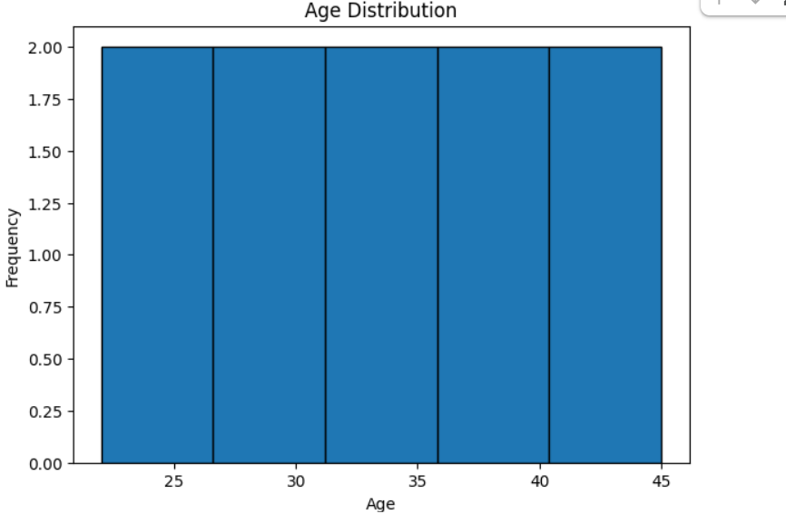
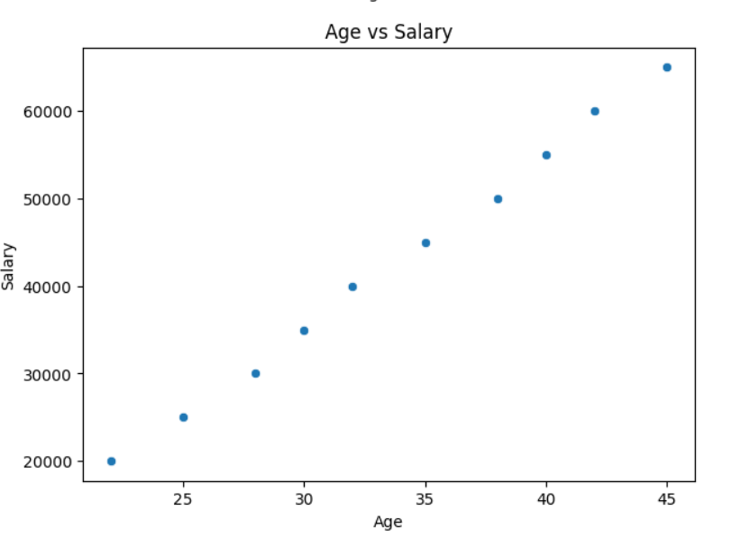
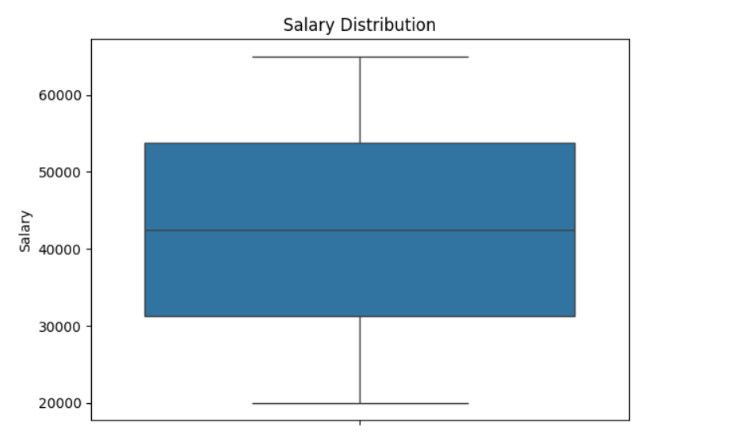

# Experiment 2: Data Visualization Using Matplotlib and Seaborn

## Aim

To visualize data using Matplotlib and Seaborn libraries.

## Algorithm

1.  **Start.**
2.  Import the Matplotlib and Seaborn libraries.
3.  Load data into a Pandas DataFrame.
4.  Plot a histogram for age distribution using `plt.hist()`.
5.  Plot a scatter plot for Age vs. Salary using `sns.scatterplot()`.
6.  Plot salary distribution using `sns.boxplot()`.
7.  Show the plots sequentially.
8.  **Stop.**


## Program
```python
import pandas as pd
import matplotlib.pyplot as plt
import seaborn as sns

# Step 1: Create a dataset
data = {
    'Age': [22, 25, 28, 30, 32, 35, 38, 40, 42, 45],
    'Salary': [20000, 25000, 30000, 35000, 40000,
               45000, 50000, 55000, 60000, 65000]
}

# Step 2: Load data into a Pandas DataFrame
df = pd.DataFrame(data)

print("Dataset:")
print(df)

# Step 3: Plot histogram for age distribution
plt.figure(figsize=(7, 5))
plt.hist(df['Age'], bins=5, edgecolor='black')
plt.title("Age Distribution")
plt.xlabel("Age")
plt.ylabel("Frequency")
plt.show()

# Step 4: Plot scatter plot for Age vs Salary
plt.figure(figsize=(7, 5))
sns.scatterplot(x='Age', y='Salary', data=df)
plt.title("Age vs Salary")
plt.xlabel("Age")
plt.ylabel("Salary")
plt.show()

# Step 5: Plot boxplot for salary distribution
plt.figure(figsize=(7, 5))
sns.boxplot(y=df['Salary'])
plt.title("Salary Distribution")
plt.ylabel("Salary")
plt.show()
```

## output
```text
### 1. Dataset
 Dataset:
   Age  Salary
0   22   20000
1   25   25000
2   28   30000
3   30   35000
4   32   40000
5   35   45000
6   38   50000
7   40   55000
8   42   60000
9   45   65000
```







## result

The program was successfully executed using Pandas, Matplotlib and Seaborn. The histogram, scatter plot and boxplot were generated successfully.

